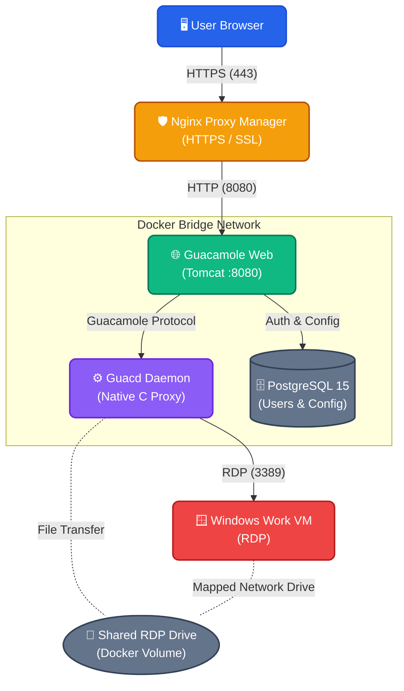

# 🥑 Sovereign Guacamole RDP

A homelab automation project for deploying Apache Guacamole and configuring an RDP connection to a Windows machine.

**Start with:** the [full architecture guide](docs/FULL_GUIDE.md), then inspect [START_HERE.sh](START_HERE.sh) and the [deployment script](scripts/deploy.sh) before executing them. The installer changes the target host and the Guacamole database. Review its assumptions, credentials, exposed ports and existing data first.

Normally, installing Guacamole requires dozens of manual steps, complex database initializations, and endless clicks to add connections. 
The deployment script is intended to automate the following steps: it installs the servers, creates your custom secure user, destroys the default insecure accounts, adds your Windows computer connection, and injects graphics optimizations to eliminate lag. Verify each step on the selected host.

---

## 🏗️ Architecture Flow



---

## 🚀 How to Install (1-Click Deployment)

Use a dedicated lab host and review these four steps:

1. **Clone this repository** onto your target server (e.g., inside a Proxmox LXC container).
2. **Enter the directory**:
   ```bash
   cd sovereign-guacamole-rdp
   ```
3. ⚠️ **CRITICAL CONFIGURATION:** Open the `START_HERE.sh` file with a text editor (like `nano START_HERE.sh`) and edit the configuration variables at the top. You **MUST** enter your target Windows machine's IP address, or the automation will fail to connect. You can also customize your new admin username and password here.
   ```bash
   export GUAC_USER="admin"
   export GUAC_PASS="<set-a-unique-local-password>"
   export WINDOWS_IP="192.168.1.100" # <-- CHANGE THIS
   ```
4. **Start the automated installation** (The Black Magic) by running:
   ```bash
   bash START_HERE.sh
   ```

The installer downloads and configures its components using the values in the launcher. Completion of the script is only an installation result: check authentication, the RDP connection, file-transfer permissions and recovery before relying on the service.

---

## 🌐 Exposing to the Internet (Nginx Proxy Manager)

*This is the most critical part!* To access Guacamole from outside your home (e.g., `https://guacamole.yourdomain.com`) with HTTPS, this recipe uses **Nginx Proxy Manager (NPM)**. Other reverse proxies require equivalent HTTPS and WebSocket configuration.

Here is the **STEP-BY-STEP** guide (word for word) on exactly what to click inside Nginx Proxy Manager:

### 1. Add the Proxy Host
1. Open your **Nginx Proxy Manager** dashboard.
2. Click on **Hosts** in the top menu, then select **Proxy Hosts**.
3. Click the green **Add Proxy Host** button in the top right corner.

### 2. Configure the "Details" Tab

This is an optional public-ingress recipe. A private VPN-only deployment can keep Guacamole off the public internet. If you expose it, a certificate and proxy settings alone do not establish adequate authentication or access control.
In the window that opens, fill out the fields *exactly* like this:
- **Domain Names:** Type your personal domain (e.g., `guacamole.yourdomain.com`) and press Enter.
- **Scheme:** Leave it as `http`
- **Forward Hostname / IP:** Type the local IP address of the server where you just installed Guacamole (e.g., `192.168.1.X_SERVER_IP`, or `127.0.0.1` if NPM is on the exact same machine).
- **Forward Port:** Type `8080`
- **Cache Assets:** Check the box (Enabled)
- **Block Common Exploits:** Check the box (Enabled)
- **Websockets Support:** Check the box (Enabled) ⚠️ *CRITICAL! Without this, your mouse and keyboard will not work in Guacamole!*

### 3. Configure the "SSL" Tab (The Green Padlock)
Now click on the "SSL" tab at the top of the same window:
- **SSL Certificate:** Click the dropdown menu and select **Request a new SSL Certificate**.
- **Force SSL:** Check the box (Enabled). This forces everyone to use the secure HTTPS connection.
- **Email Address for Let's Encrypt:** Enter your real email address. This is required to generate the security certificate automatically.
- **I Agree to the Let's Encrypt Terms of Service:** Check the box (Enabled).
- Finally, click **Save**.

Wait a few seconds. If everything is correct, the window will close and your domain will be online!
Now go to your browser, type `https://guacamole.yourdomain.com/guacamole/` and verify that authentication and the intended RDP connection work.

---

## ✨ What does the "Black Magic" do in the background?

When you run `START_HERE.sh`, we automate the ultimate "Best Practices" without you moving a finger:

- **Zero-Touch Deployment:** PostgreSQL, Guacd, and Tomcat boot up inside an isolated, secure Docker network.
- **Auto-Security:** The default `guacadmin` user is permanently destroyed to prevent brute-force attacks.
- **Extreme RDP Performance:** To eliminate stutter and input lag, we inject these parameters directly into the Guacamole engine:
  - `16-bit color depth` (reduces colour depth; bandwidth impact depends on the workload)
  - `Disable Wallpaper` (Instant desktop loading)
  - `Disable Animations & Themes` (Zero input lag)
- **Shared Drive (File Transfer):** Automatically creates a virtual "Network Drive" between your browser and the Windows machine. You can drag-and-drop files directly into your browser window, and they will instantly appear inside the virtual drive on Windows!

---

## 📜 Architecture Deep Dive & Legacy Scripts

- **Want to know how it works under the hood?** Read the [Full Architecture Guide (S.O.A.P.)](docs/FULL_GUIDE.md).
- **Looking for the original Python codes?** All the raw original Python scripts we wrote to reverse-engineer this technology in our Homelab have been sanitized and preserved in the `scripts/legacy_homelab` folder. Everything else has been merged into the master `scripts/deploy.sh`.

